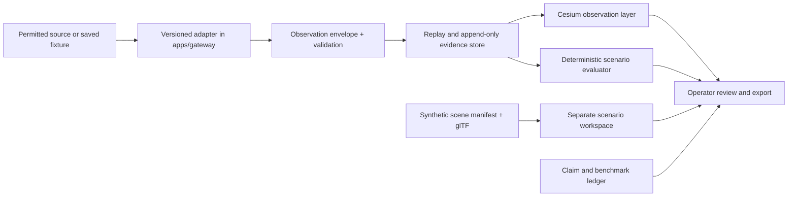

# Aetheris master product and repository plan

**Audit date:** 20 October 2026
**Decision:** focus Aetheris on a permissioned, evidence-backed **base resilience observation and planning workspace**. Keep generated worlds in a separate, explicitly synthetic scenario workspace. The first sellable proof is a trusted observation-to-decision workflow with a real user, not another broad platform claim.

This plan maps the current monorepo, screens the **57 public repositories owned by `dev4-gpt`**, and records the seven private repositories at count level only. It also includes a wider GitHub search of independent geospatial, validation, and 3D tooling. The connected GitHub API did not expose the account's starred list, so **starred repositories are not yet inventoried**. Public repository metadata, root structure, and relevant READMEs were screened; the highest-fit repositories received targeted file review. Private READMEs were checked where available but are not described in this public document. This is a prioritization audit, not a claim that every source file in 57 repositories was line-reviewed.

## Product decision and proof standard

The entry workflow is: **import a permitted observation → show its source, time, location, rights, and uncertainty → compare it with a baseline or scenario → produce a reviewable decision record**. Start with one installation, test range, or critical infrastructure use case selected through interviews. A buyer should be able to replace one feed and repeat a saved exercise without vendor-specific edits to the viewer.

The repository already supports a compelling visual demonstration, but no code audit can guarantee funding. A funding case needs a named buyer problem, permissioned data, an operator outcome against a baseline, an integration proof, a credible deployment/security route, and a pilot sponsor. See [defense readiness](DEFENSE_STARTUP_READINESS.md) for claim limits and customer gates.

## What exists now and what it proves

| Area | Current location | What works today | Main gap |
| --- | --- | --- | --- |
| Geospatial interface | `gods-eye-view/` | Cesium browser globe, local layers, scenario UI | Separate verified observations from visually similar demo/simulation layers; measure operator tasks |
| Observation review | `gods-eye-view/src/agents/observationEvidence.js`, `src/data/localGeojson.js` | Local GeoJSON/SensorThings-style review, source/rights/age fields, report export | Metadata is user declared; no authenticated, permissioned live feed or canonical envelope |
| Gateway | `apps/gateway/src/server.js` | Fastify API and WebSocket shell | Several named feed routes return hard-coded examples; no production adapter/replay contract |
| Modular interface | `gods-eye-view/src/agents/mosaAdapterAgent.js` | Metadata catalog and protocol labels | No demonstrated external adapter swap or program-specific conformance result |
| Scenario logic | `gods-eye-view/src/agents/` | Deterministic browser simulations with tests | Assumptions are not calibrated against operational data |
| World Studio | `apps/studio/`, `packages/inference-bridge/` | Local UI and offline synthetic inference router | UI currently advertises an online engine, hybrid provider, and fixed VRAM values that do not reflect this runtime |
| World evaluation | `packages/worldgen-bench/`, `packages/spatial-grounding/` | User-supplied paired camera/depth/embedding measures; spatial utilities | No mesh, terrain, geographic, or task-validity benchmark |
| Agent and tool services | `packages/earthmind-mcp/`, `packages/director-swarm/`, `packages/security-shield/` | Prototype tool schemas, orchestration, prompt scanning | Need scoped permissions, provenance, traceability, and measured usefulness before operational claims |
| Verification | `.github/workflows/ci.yml`, package tests | Local tests and a revised full CI gate | New remote workflow has not run on a pushed commit; prior public runs failed during install |

The root [README](README.md) still uses language such as “live production,” “60 fps,” “14 real-time streams,” and “ground truth.” Audit each statement against deployed behavior and a dated measurement before using it externally. The [OpenArchai audit](https://github.com/dev4-gpt/OpenArchai/blob/main/AETHERIS_SPATIAL_INDEPENDENT_AUDIT.md) is a useful **dated lead**, not current proof.

The [AlphaEarth, OSIRIS, and WorldClaw review](ALPHAEARTH_OSIRIS_WORLDCLAW_REVIEW.md) records a 23 October source check. In particular, the existing AlphaEarth-branded cartridge used coordinate-seeded synthetic values rather than Google embeddings; its user-visible outputs are now labeled as synthetic. The next real AlphaEarth trial is an annual change layer with licensed access and held-out validation, not direct hazard percentages.

## Target architecture and exact insertion points

| Addition | Put it here | Borrow the idea from | Required contract / acceptance test |
| --- | --- | --- | --- |
| Canonical observation envelope | New `packages/observation-contract/`; validate in `apps/gateway/src/server.js`, consume in `gods-eye-view/src/agents/observationEvidence.js` | `UCIP` ingestion layout, current local import | `schemaVersion`, stable ID, source, source time, received time, geometry/CRS, units, classification/handling, rights, quality flags, and `synthetic=false`; reject invalid coordinates and missing source |
| One permitted adapter and replay | New `apps/gateway/src/adapters/` and `test/fixtures/` | `agentos` tool contracts; `DispatchIQ` saved runs | Same normalized output from live permissioned input and a saved fixture; explicit stale/disconnected state; no endpoint labeled live when serving fixtures |
| Provenance in the viewer | Existing local layer and evidence panel in `gods-eye-view/src/` | Current evidence panel, `UCIP` concepts | Always-visible live/delayed/synthetic/unknown labels; source/time/rights available by keyboard and export; missing metadata cannot silently become verified |
| Deterministic evaluation | New `packages/scenario-eval/` with immutable fixture IDs and report format | `DispatchIQ`, `veloce-forge`, `tokenforge` | Freeze inputs, baseline and held-out cases; record evaluator version/code hash; proposals cannot edit their own score; failure cases saved |
| Open adapter demonstration | Version contract above plus second independent sample adapter | `agentos` schema discipline | Third party swaps one feed without changing Cesium view code; publish conformance logs and limits rather than MOSA/SOSA compliance claim |
| Synthetic world sandbox | `apps/studio/` and new `packages/scene-manifest/`; do not merge with observation store | WorldClaw paper, current spatial grounding | Explicit synthetic manifest, asset rights, local frame, scale, georeference transform, generator/version; glTF preview; visible synthetic label; mesh and browser performance checks |
| Evidence and claim ledger | New `docs/evidence/` templates, public redacted examples | `ResearchOS`, `OpenArchai`, `veloce-research-os` | Every numerical/partner/standards statement has owner, date, method, artifact, limits, and permission to publish |
| Operator UI system | Current vanilla JS/CSS in `gods-eye-view/` and `apps/studio/` | `radix-ui-design-system` accessibility principles | Tokenize status/severity colors; test focus order, keyboard operation, dialog focus return, contrast, and screen-reader state. Radix primitives require React; use them only if a bounded React workspace is introduced for a justified need. |

### Data and model boundary

Treat **observation**, **inference**, **simulation**, and **generated scenery** as different record types. A model output may propose a hypothesis, but the viewer and export must preserve the input source, model/version, uncertainty, and reviewer action. A generated mesh is not terrain survey data. Keep coordinate transformations, units, stale-data handling, and source rights explicit. Never use a fictional scenario score as field performance or a cost-per-kill claim.

## Sequenced delivery plan

| Stage | Concrete work | Exit gate |
| --- | --- | --- |
| **0: honest demo (week 1)** | Replace fixed World Studio online/provider/VRAM indicators with actual offline/synthetic state; mark every gateway sample route; reconcile README claims with a claim ledger; keep upstream attribution | A new visitor can identify demo data and simulation without reading source code; no claim relies on an unrun benchmark |
| **1: one workflow (weeks 1–4)** | Interview at least 15 authorized users; select one decision and one permitted feed; implement observation contract, fixture replay, stale and error states, provenance UI | Customer problem repeated by a target buyer; replay and permitted feed use the same schema; no silent fixture/live switch |
| **2: independent repeatability (weeks 4–8)** | Build deterministic baseline and held-out scenario cases; save versioned reports; invite an external adapter author to swap a sample feed | Repeatable result with pass/fail cases and limitations; viewer code unchanged by adapter swap; CI passes remotely |
| **3: pilot evidence (weeks 6–12)** | Permissioned tabletop or range observation; compare task time, missed signals, setup time, and false/stale signal handling with current workflow; agree security/data rights and sponsor | Signed or written pilot scope, named sponsor, measured operator result and full cost estimate; failures included in report |
| **4: optional world detail (after stage 2)** | Test one synthetic scene for a specific planning task, with licensed assets, glTF, scene manifest, visual review, browser/mesh benchmark | User study shows task improvement; no false impression that generated geometry is mapped reality |

Do **not** make a multi-agent OS, open-ended model marketplace, engagement simulator, or expensive scene generation the critical path to the first pilot. Expand only when a buyer task and evaluation demonstrate value.

## Owned repository inventory and disposition

The groups below account for all **57 public** owned repositories. “Use” means adapt a reviewed pattern or small licensed component after provenance and dependency checks; it does not authorize copying an entire repository. Seven private repositories were visible in account metadata but are omitted from this public plan; no private content is reproduced.

### Existing base — 2

- [`aetheris`](https://github.com/dev4-gpt/aetheris): this product repository and source of truth.
- [`gods-eye-view`](https://github.com/dev4-gpt/gods-eye-view): geospatial foundation already represented in the monorepo; retain upstream license and attribution.

### Highest-value ideas to adapt — 9

| Repository | Best fit | Avoid |
| --- | --- | --- |
| [`DispatchIQ`](https://github.com/dev4-gpt/DispatchIQ) | Saved cases, deterministic checker, held-out evaluation | Field-service weights and routing policy |
| [`veloce-forge`](https://github.com/dev4-gpt/veloce-forge) | Exact revision/hash approval and bounded evaluation | Runtime code generation and unlicensed source transfer |
| [`tokenforge`](https://github.com/dev4-gpt/tokenforge) | Fixed harness, baseline remeasurement, equivalence checks | Kernel optimizations unrelated to this product |
| [`OpenArchai`](https://github.com/dev4-gpt/OpenArchai) | Dated independent claim audit | Treating old findings as current measurements |
| [`UCIP`](https://github.com/dev4-gpt/UCIP) | Data-fusion layout and source metadata | Uncalibrated hotspot constants; code without verified root license |
| [`ResearchOS`](https://github.com/dev4-gpt/ResearchOS) | Evidence and citation workflow | Generated research as product proof; unlicensed source transfer |
| [`veloce-research-os`](https://github.com/dev4-gpt/veloce-research-os) | Evaluation artifact ledger | General research-agent runtime |
| [`agentos`](https://github.com/dev4-gpt/agentos) | Versioned tool schemas, audit, permission concepts | Full general-purpose integration/auth platform |
| [`local-AgenticOS`](https://github.com/dev4-gpt/local-AgenticOS) | Local-first operator experience and previously curated candidate research | General AI OS features in the focused product |

### Conditional references — 11

`blissful-bose` (visual model robustness), `llm-assisted-customer-support` (golden-set evaluation), `MetaScope` (archived React UI ideas), `full-stack-ai-agent-template` (generic stack reference), `web-ui` and `opengoat` (agent UX/runtime references), `computer-vision`, `Agentic-Systems`, and `CAIS` (education/research), `n8n` and `n8n-workflows` (internal workflow automation). Revisit only for a specific implementation need. Do not substitute these for validated product modules.

### No current product transfer — 35

`Adversarial-attacks`, `ai-agency`, `Autonomous-Legal-Document-Analyzer`, `career-ops-aihawk-bridge`, `chatgpt-game-hackathon`, `Claude-code-multi-model`, `Compiled15`, `Context-Engineering`, `ContractorOS`, `Debugging-voice-agent`, `desktop-tutorial`, `dl-demos`, `FocusFlow`, `FRED-dashboard`, `GenAI-and-PredAI-for-improved-industrial-processes`, `intelligent-maxwell`, `Internships`, `jobreach`, `jobvis`, `markexis`, `MindBody`, `moltbot`, `MultiAgent-stock-crypto-analyst`, `NLP`, `PEFT-using-LoRA`, `portfolio-website`, `prospect-previews`, `ragchatbot-codebase`, `seo-os`, `symlink`, `the-gatekeeper`, `trypost`, `VoiceAI`, `websitegenerator`, `wiza`. They are mainly separate businesses, educational/research repositories, generic templates, or unrelated tools. A specific future requirement can change their ranking after code and rights review. `ContractorOS` is AGPL-3.0; importing it into this product would require a deliberate license review.

## External open-source and starred-repo decision rule

The [WorldClaw feasibility review](WORLDCLAW_FEASIBILITY.md) is the current decision: study the scene-plan, editable-region, and render/refine approach, but do not claim or import a WorldClaw implementation while code/weights/license are unreleased. The [Radix UI primitives documentation](https://www.radix-ui.com/primitives/docs/overview/introduction) informs accessibility for a future React surface; current Aetheris screens are vanilla JavaScript, so adding React and Radix solely for visual polish would add migration cost without proving buyer value.

### Wider GitHub search: independent building blocks

**Screened 21 October 2026.** These projects were selected for the concrete gaps above; they are **not claimed to be on the account's starred list**. Licenses below are the repository-level terms inspected on the stated date, not a clearance of all dependencies, sample assets, hosted data, or deployment uses. “Trial” means build an isolated proof before adding a dependency.

| Project and source | License | Where it could fit | Decision and trigger |
| --- | --- | --- | --- |
| [`placemark/check-geojson`](https://github.com/placemark/check-geojson) ([license](https://github.com/placemark/check-geojson/blob/main/LICENSE)) | MIT | `gods-eye-view/src/agents/observationEvidence.js` or new `packages/observation-contract/` | **Trial first.** Improve import errors for user-supplied GeoJSON; compare against current point-only checks and malformed fixtures. Its README says the API is not yet stable and it ignores the `crs` member, so retain explicit CRS policy and version pinning. |
| [`FraunhoferIOSB/FROST-Server`](https://github.com/FraunhoferIOSB/FROST-Server) ([license](https://github.com/FraunhoferIOSB/FROST-Server/blob/v2.x/LICENSE)) | LGPL-3.0 | `apps/gateway/src/adapters/` interoperability fixture or later self-hosted service | **Trial as an external test server** for a SensorThings adapter; avoid embedding the Java server in the browser product. A pilot must justify hosting, security, and license obligations. Already noted in [open-source adoption](OPEN_SOURCE_ADOPTION.md). |
| [`opengeospatial/ogcapi-features`](https://github.com/opengeospatial/ogcapi-features) | OGC specification terms | Versioned external feature API contract | **Reference standard**, not a copied code module. Use only if a buyer needs queryable spatial collections; conformance needs an actual test, not endpoint naming. |
| [`stac-utils/stac-fastapi`](https://github.com/stac-utils/stac-fastapi) ([license](https://github.com/stac-utils/stac-fastapi/blob/main/LICENSE)) | MIT | Separate imagery catalog service behind `apps/gateway/` | **Watch for a real catalog need.** It is a Python service, so adding it before a pilot would increase the stack and operational burden. STAC metadata alone does not grant imagery use rights. |
| [`stac-utils/stac-api-validator`](https://github.com/stac-utils/stac-api-validator) ([license](https://github.com/stac-utils/stac-api-validator/blob/main/LICENSE)) | Apache-2.0 | CI conformance check if a STAC API is introduced | **Adopt with the API, not before.** Use a frozen sample catalog and published conformance class in CI. |
| [`developmentseed/titiler`](https://github.com/developmentseed/titiler) ([license](https://github.com/developmentseed/titiler/blob/main/LICENSE)) | MIT | Raster/COG tile service beside, not inside, the Cesium viewer | **Watch.** Trial only when a permitted pilot requires server-side raster tiling. Its current README says the old `titiler` metapackage is no longer the installation path. |
| [`PDAL/PDAL`](https://github.com/PDAL/PDAL) ([license](https://github.com/PDAL/PDAL/blob/master/LICENSE.txt)) | BSD | Offline survey or point-cloud preprocessing | **Conditional.** Useful only if a partner supplies rights-cleared point clouds. Preserve measured survey origin and coordinate transforms; do not call generated meshes surveyed data. |
| [`bimdata/py3dtiles`](https://github.com/bimdata/py3dtiles) ([license](https://github.com/bimdata/py3dtiles/blob/main/LICENSE)) | Apache-2.0 | Offline point-cloud-to-3D Tiles conversion for the scenario workspace | **Conditional after stage 2.** Test sample format, Cesium rendering, and third-party asset notices before adopting. |
| [`KhronosGroup/glTF-Validator`](https://github.com/KhronosGroup/glTF-Validator) ([license](https://github.com/KhronosGroup/glTF-Validator/blob/main/LICENSE)) | Apache-2.0 | `packages/scene-manifest/` CI asset gate | **Best first world-sandbox trial.** It emits JSON reports on glTF/GLB structure and asset stats; combine with rights and geographic checks because format validity is not realism. |
| [`mikedh/trimesh`](https://github.com/mikedh/trimesh) ([license](https://github.com/mikedh/trimesh/blob/main/LICENSE.md)) | MIT | Offline mesh inspection for `packages/worldgen-bench/` | **Conditional after stage 2.** Check scale, bounds, connectivity, and contact geometry; run server/offline rather than shipping a Python mesh stack to the browser. |

**Integration order:** try `check-geojson` against the current importer before changing the observation contract; use a FROST fixture to prove one SensorThings adapter; add STAC/TiTiler only for a rights-cleared imagery workflow; add glTF Validator and optional mesh tools only when a synthetic scene solves a measured planning task. No large service is necessary for the first replayable observation demo.

When the starred list becomes available, add each candidate to a dated inventory with URL, license, maintenance/activity, capability, target Aetheris path, dependency and compute cost, data/model rights, security exposure, and a **use / trial / watch / reject** decision. Prioritize candidates that directly improve the stage 1–3 proof gates. A previous curated external-candidate document in `local-AgenticOS` is research input, **not** evidence of the account's current stars.

For any cross-repo transfer, verify `LICENSE`, third-party notices, transitive dependencies, weights/data terms, and attribution before copying. Prefer a small adapter behind a testable contract. Record the exact upstream commit and local changes. Never infer reuse rights from ownership, a README badge, or GitHub visibility.

## Investor review packet to build alongside the product

1. A 90-second demo of the one observation workflow, with a visible feed label and replay option.
2. A dated architecture diagram and third-party adapter swap report.
3. A benchmark packet: frozen inputs, baseline, held-out cases, operator outcomes, errors, and limitations.
4. Permissioned customer evidence: interview synthesis, named pilot sponsor, data rights and deployment requirements. Keep confidential artifacts outside the public repository.
5. A claim ledger reconciling the website, README, deck, demo, and reports. Mark hypotheses and simulated numbers plainly.

This packet can make the company easier to evaluate; it cannot guarantee a YC or defense award. Funding and procurement decisions depend on buyer demand and evidence beyond the repository.
